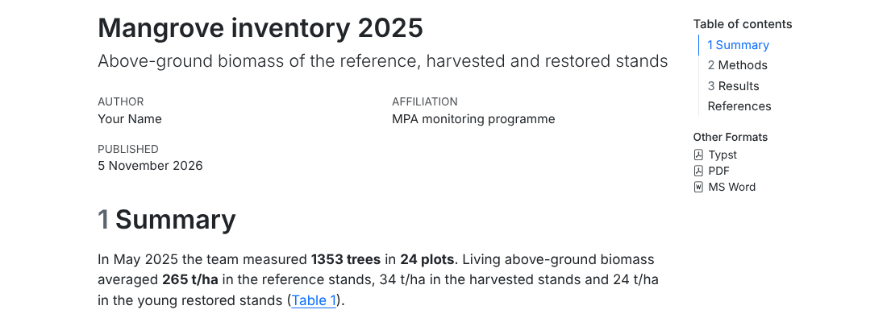
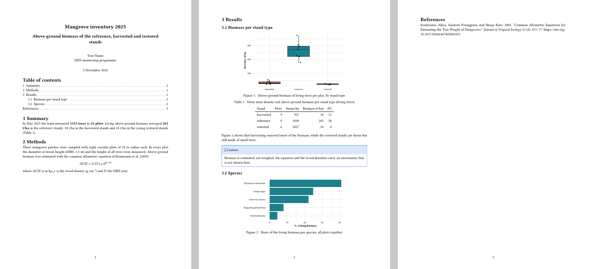

```{r setup, include=FALSE}
source("R/course_helpers.R")
source("R/advanced_pipeline.R")
suppressMessages({library(dplyr); library(ggplot2)})
```

::: objectives
::: en
#### By the end of this session you will be able to
- explain what **Quarto** is and how it differs from R Markdown;
- convert an `.Rmd` report to a `.qmd` report (YAML, chunk options with `#|`, inline code);
- number and **cross-reference** figures, tables, sections and equations (`@fig-…`, `@tbl-…`);
- add a **table of contents**, numbered sections, **lists of figures and tables**;
- cite publications from a **BibTeX** file and produce the reference list automatically, in the style you need (CSL);
- render one source to **HTML, Word and PDF**.
:::
::: fr
#### À la fin de cette séance vous saurez
- expliquer ce qu'est **Quarto** et ce qui le distingue de R Markdown ;
- convertir un rapport `.Rmd` en rapport `.qmd` (YAML, options de chunk avec `#|`, code en ligne) ;
- numéroter figures, tableaux, sections et équations et y **renvoyer** (`@fig-…`, `@tbl-…`) ;
- ajouter une **table des matières**, des sections numérotées, des **listes des figures et des tableaux** ;
- citer des publications depuis un fichier **BibTeX** et produire automatiquement la liste des références, dans le style voulu (CSL) ;
- produire, à partir d'une seule source, du **HTML, du Word et du PDF**.
:::
:::

::: {.callout .ecology}
::: en
**Data of this session (simulated).** The **mangrove inventory** of May 2025: 24 circular plots of 10 m radius in three patches (Ankarabe, Ambalakely, Sarondrano), each patch with reference, harvested and restored stands. In each plot the team measured every tree: species, **DBH** (diameter at breast height, 1.3 m, with a diameter tape), height (clinometer) and status (alive, dead, cut). `mangrove_species.csv` gives a wood density per species (approximate values for the exercise; for real work use the Global Wood Density Database). Two field errors remain: a few species codes in lower case, and four DBH typed without the decimal point (33 instead of 3.3). *Type:* one row = one tree; continuous measurements and categories. `references.bib` contains real publications cited in the report.
:::
::: fr
**Données de cette séance (simulées).** L'**inventaire des mangroves** de mai 2025 : 24 placettes circulaires de 10 m de rayon dans trois massifs (Ankarabe, Ambalakely, Sarondrano), chaque massif avec des peuplements de référence, exploités et restaurés. Dans chaque placette, l'équipe a mesuré chaque arbre : espèce, **DHP** (diamètre à hauteur de poitrine, 1,3 m, au ruban diamétrique), hauteur (clinomètre) et état (vivant, mort, coupé). `mangrove_species.csv` donne une densité du bois par espèce (valeurs approximatives pour l'exercice ; pour un vrai travail, utilisez la Global Wood Density Database). Deux erreurs de terrain restent : quelques codes d'espèces en minuscules, et quatre DHP saisis sans la virgule (33 au lieu de 3,3). *Type :* une ligne = un arbre ; mesures continues et catégories. `references.bib` contient de vraies publications citées dans le rapport.
:::
:::

`r dl("mangrove_report.qmd", "mangrove_report.qmd (template)", dir = "templates/advanced/quarto")` `r dl("references.bib", "references.bib", dir = "templates/advanced/quarto")`

## [What is Quarto?]{.en}[Qu'est-ce que Quarto ?]{.fr} {#what}

::: en
**Quarto** is the successor of R Markdown, made by the same team (Posit). It uses the same engine for R code (**knitr**) and the same converter (**pandoc**), so everything you learned in Sessions A3–A4 is still valid. What it adds:

- one tool for R, Python and Julia, with the same syntax for all outputs (reports, slides, websites, books);
- cross-references, callouts, figure layouts, PDF through **Typst** built in — no extra packages such as bookdown;
- chunk options written **inside** the chunk, as YAML lines starting with `#|`.

Quarto is **included in RStudio** (recent versions). You can also install it separately from <https://quarto.org>. In RStudio: *File → New File → Quarto Document*; the **Render** button replaces Knit.
:::
::: fr
**Quarto** est le successeur de R Markdown, fait par la même équipe (Posit). Il utilise le même moteur pour le code R (**knitr**) et le même convertisseur (**pandoc**) : tout ce que vous avez appris aux séances A3–A4 reste valable. Ce qu'il apporte :

- un seul outil pour R, Python et Julia, avec la même syntaxe pour toutes les sorties (rapports, diapositives, sites web, livres) ;
- renvois, encadrés (*callouts*), mises en page de figures, PDF via **Typst** intégrés — sans package supplémentaire comme bookdown ;
- les options de chunk écrites **dans** le chunk, en lignes YAML commençant par `#|`.

Quarto est **inclus dans RStudio** (versions récentes). Vous pouvez aussi l'installer séparément depuis <https://quarto.org>. Dans RStudio : *File → New File → Quarto Document* ; le bouton **Render** remplace Knit.
:::

## [From .Rmd to .qmd]{.en}[De .Rmd à .qmd]{.fr} {#convert}

::: en
| | R Markdown (`.Rmd`) | Quarto (`.qmd`) |
|---|---|---|
| output in YAML | `output: html_document` | `format: html` |
| options of the whole document | `knitr::opts_chunk$set(echo = FALSE)` | `execute: echo: false` in the YAML |
| chunk options | ```` ```{r trend, fig.cap = "…"} ```` | `#| label: fig-trend` and `#| fig-cap: "…"` inside the chunk |
| inline code | `` `r knitr::inline_expr("x")` `` | `` `{r} x` `` (and the old form still works) |
| figure cross-reference | `\@ref(fig:trend)` with bookdown | `@fig-trend` |
| table cross-reference | `\@ref(tab:cover)` | `@tbl-cover` |
| page break | `\newpage` (PDF only) | `` (all formats) |
| render | Knit, `rmarkdown::render()` | Render, `quarto render file.qmd` (Terminal) or `quarto::quarto_render()` |
:::
::: fr
| | R Markdown (`.Rmd`) | Quarto (`.qmd`) |
|---|---|---|
| sortie dans le YAML | `output: html_document` | `format: html` |
| options du document entier | `knitr::opts_chunk$set(echo = FALSE)` | `execute: echo: false` dans le YAML |
| options de chunk | ```` ```{r trend, fig.cap = "…"} ```` | `#| label: fig-trend` et `#| fig-cap: "…"` dans le chunk |
| code en ligne | `` `r knitr::inline_expr("x")` `` | `` `{r} x` `` (l'ancienne forme marche encore) |
| renvoi à une figure | `\@ref(fig:trend)` avec bookdown | `@fig-trend` |
| renvoi à un tableau | `\@ref(tab:cover)` | `@tbl-cover` |
| saut de page | `\newpage` (PDF seulement) | `` (tous formats) |
| produire | Knit, `rmarkdown::render()` | Render, `quarto render fichier.qmd` (Terminal) ou `quarto::quarto_render()` |
:::

::: {.callout .tip}
::: en
Option names use a **dash** in Quarto (`fig-cap`, `fig-width`, `code-fold`) where R Markdown used a dot (`fig.cap`). The dotted names are still accepted in `#|` lines, but use the dashes in new documents.
:::
::: fr
Les noms d'options prennent un **tiret** dans Quarto (`fig-cap`, `fig-width`, `code-fold`) là où R Markdown utilisait un point (`fig.cap`). Les noms à point sont encore acceptés dans les lignes `#|`, mais utilisez les tirets dans les nouveaux documents.
:::
:::

```{r, echo=FALSE}
fa(c("`#| option: value`", "a chunk option written **inside** the chunk, one per line, in YAML style (`key: value`, `true`/`false` in lower case)", "une option de chunk écrite **dans** le chunk, une par ligne, au style YAML (`clé: valeur`, `true`/`false` en minuscules)", "", ""),
   c("`#| label: fig-agb`", "name of the chunk; the prefix `fig-` / `tbl-` makes it a numbered figure / table that `@fig-agb` can cite", "nom du chunk ; le préfixe `fig-` / `tbl-` en fait une figure / un tableau numéroté que `@fig-agb` peut citer", "text without spaces", "texte sans espaces"),
   c("`#| fig-cap:`, `#| tbl-cap:`", "caption of the figure / table", "légende de la figure / du tableau", "text in quotes", "texte entre guillemets"),
   c("`#| fig-width:`, `#| fig-height:`", "size of the figure, in inches", "taille de la figure, en pouces", "numbers", "nombres"),
   c("`#| echo:`, `#| include:`, `#| eval:`, `#| warning:`", "the same options as in R Markdown (Session A3), with YAML values", "les mêmes options qu'en R Markdown (séance A3), avec des valeurs YAML", "`true` / `false`", "`true` / `false`"),
   c("`` `{r} x` ``", "inline code in Quarto: replaced by the value of `x`", "code en ligne dans Quarto : remplacé par la valeur de `x`", "", ""))
```

## [The template of this session]{.en}[Le modèle de cette séance]{.fr} {#template}

::: en
Download `mangrove_report.qmd` and `references.bib` (above), put them in `reports/` of your project, and the mangrove CSV files in `data/raw/`. Read it calmly: every feature of this session is in it.
:::
::: fr
Téléchargez `mangrove_report.qmd` et `references.bib` (ci-dessus), placez-les dans `reports/` de votre projet, et les fichiers CSV des mangroves dans `data/raw/`. Lisez-le tranquillement : toutes les notions de cette séance s'y trouvent.
:::

`r show_file("templates/advanced/quarto/mangrove_report.qmd")`

::: en
Here is the top of the HTML output (with the links to the other formats, top right), and the three pages of the PDF made with Typst:
:::
::: fr
Voici le haut de la sortie HTML (avec les liens vers les autres formats, en haut à droite), et les trois pages du PDF fait avec Typst :
:::

{width=85%}

{width=100%}

## [The YAML header]{.en}[L'en-tête YAML]{.fr} {#yaml}

::: en
Quarto keys are written with a **hyphen** (`number-sections`, `code-fold`), R Markdown keys with an **underscore** (`number_sections`, `code_folding`): same idea, different names — one more case where two tools do not use the same name for the same thing. Indentation (two spaces) says which key belongs to which.

**Top level** (valid for every format):

| Key | What it does | Value it expects |
|---|---|---|
| `title`, `subtitle` | texts at the top of the document | text |
| `author` | the author(s); a simple text, or a list where each author has `name` and optionally `affiliation`, `email`, `orcid` | text, or a list starting with `- name:` |
| `date` | date under the title; `today` = the day of rendering | `today`, or a date `2025-11-30` |
| `date-format` | how the date is written: `D` day, `MMMM` month in letters, `YYYY` year | a pattern, e.g. `"D MMMM YYYY"` → 5 November 2026 |
| `lang` | language of the words Quarto writes itself (Table of contents, Figure, Table, and, References) | `en`, `fr`… |
| `format` | opens the list of outputs; each one (`html`, `typst`, `pdf`, `docx`) has its own options indented below it | output names |
| `bibliography` | the BibTeX file of the references (next section) | path to a .bib file |
| `execute` | default options of **all** chunks (below) | options indented below |

**Under `format:`**:

| Key | Formats | What it does | Value it expects |
|---|---|---|---|
| `toc` | all | adds a table of contents | `true` / `false` |
| `toc-depth` | all | heading levels in the table of contents | a number (default 3) |
| `number-sections` | all | numbers the headings 1, 1.1… (needed for `@sec-` references) | `true` / `false` |
| `code-fold` | html | adds a *Code* button above each chunk; code hidden until the reader clicks | `true` / `false` |
| `embed-resources` | html | puts images, styles and scripts **inside** the .html: one file to send | `true` / `false` |
| `papersize` | typst, pdf | paper size | `a4`, `us-letter` |
| `margin` with `x` and `y` | typst | `x` = left and right margins, `y` = top and bottom | lengths: `2.5cm`, `1in` |
| `geometry` | pdf (LaTeX) | margins, in the syntax of the LaTeX package *geometry* | `margin=2.5cm`, or `left=3cm,right=2cm` |
| `citeproc` | typst | lets Quarto format the citations (author–year, as in HTML) instead of Typst's own numbered style | `true` / `false` |
| `lof`, `lot` | pdf (LaTeX) | **l**ist **o**f **f**igures, **l**ist **o**f **t**ables after the table of contents | `true` / `false` |
| `reference-doc` | docx | Word file whose styles are copied (Session A9) | path to a .docx |

**Under `execute:`** (the same option written as `#|` in a chunk wins over it):

| Key | What it does | Value |
|---|---|---|
| `echo` | shows the code in the output | `true` / `false` |
| `warning`, `message` | shows R warnings / messages (e.g. those of `library()`) | `true` / `false` |
| `cache` | keeps chunk results between two renderings | `true` / `false` |
| `freeze` | in a project only (Session A9): re-run the code only when the file changed | `auto`, `true`, `false` |

The list of all options of a format is in the Quarto reference: <https://quarto.org/docs/reference/> (choose *HTML*, *Typst*, *PDF* or *Word*). In RStudio, **Ctrl + Space** inside the YAML proposes the valid keys.
:::
::: fr
Les clés Quarto s'écrivent avec un **tiret** (`number-sections`, `code-fold`), celles de R Markdown avec un **tiret bas** (`number_sections`, `code_folding`) : même idée, noms différents — encore un cas où deux outils n'utilisent pas le même nom pour la même chose. L'indentation (deux espaces) indique quelle clé appartient à laquelle.

**Premier niveau** (valable pour tous les formats) :

| Clé | Ce qu'elle fait | Valeur attendue |
|---|---|---|
| `title`, `subtitle` | textes en haut du document | texte |
| `author` | le ou les auteurs ; un texte simple, ou une liste où chaque auteur a `name` et éventuellement `affiliation`, `email`, `orcid` | texte, ou une liste commençant par `- name:` |
| `date` | date sous le titre ; `today` = le jour de la production | `today`, ou une date `2025-11-30` |
| `date-format` | forme de la date : `D` jour, `MMMM` mois en lettres, `YYYY` année | un motif, ex. `"D MMMM YYYY"` → 5 novembre 2026 |
| `lang` | langue des mots que Quarto écrit lui-même (Table des matières, Figure, Tableau, et, Références) | `en`, `fr`… |
| `format` | ouvre la liste des sorties ; chacune (`html`, `typst`, `pdf`, `docx`) a ses options décalées en dessous | noms de sorties |
| `bibliography` | le fichier BibTeX des références (section suivante) | chemin vers un .bib |
| `execute` | options par défaut de **tous** les chunks (ci-dessous) | options décalées en dessous |

**Sous `format:`** :

| Clé | Formats | Ce qu'elle fait | Valeur attendue |
|---|---|---|---|
| `toc` | tous | ajoute une table des matières | `true` / `false` |
| `toc-depth` | tous | niveaux de titres dans la table des matières | un nombre (3 par défaut) |
| `number-sections` | tous | numérote les titres 1, 1.1… (nécessaire pour les renvois `@sec-`) | `true` / `false` |
| `code-fold` | html | ajoute un bouton *Code* au-dessus de chaque chunk ; code caché jusqu'au clic du lecteur | `true` / `false` |
| `embed-resources` | html | met images, styles et scripts **dans** le .html : un seul fichier à envoyer | `true` / `false` |
| `papersize` | typst, pdf | format du papier | `a4`, `us-letter` |
| `margin` avec `x` et `y` | typst | `x` = marges gauche et droite, `y` = haut et bas | longueurs : `2.5cm`, `1in` |
| `geometry` | pdf (LaTeX) | marges, dans la syntaxe du package LaTeX *geometry* | `margin=2.5cm`, ou `left=3cm,right=2cm` |
| `citeproc` | typst | laisse Quarto mettre en forme les citations (auteur–date, comme en HTML) au lieu du style numéroté propre à Typst | `true` / `false` |
| `lof`, `lot` | pdf (LaTeX) | liste des figures (*list of figures*), liste des tableaux (*list of tables*) après la table des matières | `true` / `false` |
| `reference-doc` | docx | fichier Word dont les styles sont copiés (séance A9) | chemin vers un .docx |

**Sous `execute:`** (la même option écrite en `#|` dans un chunk l'emporte) :

| Clé | Ce qu'elle fait | Valeur |
|---|---|---|
| `echo` | montre le code dans la sortie | `true` / `false` |
| `warning`, `message` | montre les avertissements / messages de R (ex. ceux de `library()`) | `true` / `false` |
| `cache` | garde les résultats des chunks entre deux productions | `true` / `false` |
| `freeze` | dans un projet seulement (séance A9) : ne relance le code que si le fichier a changé | `auto`, `true`, `false` |

La liste de toutes les options d'un format est dans la référence Quarto : <https://quarto.org/docs/reference/> (choisissez *HTML*, *Typst*, *PDF* ou *Word*). Dans RStudio, **Ctrl + Espace** dans le YAML propose les clés valides.
:::

## [Cross-references]{.en}[Renvois]{.fr} {#xref}

::: en
A label with the right **prefix** makes an element numbered and referable:

| Element | Label | Caption | In the text |
|---|---|---|---|
| figure (chunk) | `#| label: fig-agb` | `#| fig-cap: "…"` | `@fig-agb` → "Figure 1" |
| table (chunk) | `#| label: tbl-status` | `#| tbl-cap: "…"` | `@tbl-status` → "Table 1" |
| section | `# Results {#sec-results}` | | `@sec-results` → "Section 3" (needs `number-sections: true`) |
| equation | `$$ … $$ {#eq-agb}` | | `@eq-agb` → "Equation 1" |
| image file | `{#fig-map}` | the text in brackets | `@fig-map` |

Several figures side by side: `#| layout-ncol: 2` in a chunk that makes two plots, with `#| fig-subcap: ["Reference", "Harvested"]`.
:::
::: fr
Un label avec le bon **préfixe** rend un élément numéroté et citable :

| Élément | Label | Légende | Dans le texte |
|---|---|---|---|
| figure (chunk) | `#| label: fig-agb` | `#| fig-cap: "…"` | `@fig-agb` → « Figure 1 » |
| tableau (chunk) | `#| label: tbl-status` | `#| tbl-cap: "…"` | `@tbl-status` → « Tableau 1 » |
| section | `# Résultats {#sec-results}` | | `@sec-results` → « Section 3 » (demande `number-sections: true`) |
| équation | `$$ … $$ {#eq-agb}` | | `@eq-agb` → « Équation 1 » |
| fichier image | `{#fig-map}` | le texte entre crochets | `@fig-map` |

Plusieurs figures côte à côte : `#| layout-ncol: 2` dans un chunk qui fait deux graphiques, avec `#| fig-subcap: ["Référence", "Exploité"]`.
:::

## [Citations and references]{.en}[Citations et références]{.fr} {#citations}

::: en
1. Keep your references in a **BibTeX** file (`references.bib`). Zotero exports it (*File → Export library → BibTeX*), and the **Better BibTeX** extension keeps it up to date automatically; Google Scholar and journal websites also give BibTeX entries.
2. Declare it in the YAML: `bibliography: references.bib`.
3. Cite with the **key** of the entry:

| You write | You get (default style, author–year) |
|---|---|
| `[@komiyama2005]` | (Komiyama, Poungparn, and Kato 2005) |
| `@komiyama2005` | Komiyama, Poungparn, and Kato (2005) |
| `[@hill2004; @komiyama2005]` | (Hill and Wilkinson 2004; Komiyama, Poungparn, and Kato 2005) |
| `[-@komiyama2005]` | (2005) — when the authors are already named |
| `[@hill2004, p. 25]` | (Hill and Wilkinson 2004, 25) |

4. The reference list is written at the end, or where you put `::: {#refs}` `:::`.
5. Another style (APA, a journal style…): download its `.csl` file from the Zotero Style Repository (<https://www.zotero.org/styles>) and add `csl: apa.csl` to the YAML.
:::
::: fr
1. Gardez vos références dans un fichier **BibTeX** (`references.bib`). Zotero l'exporte (*Fichier → Exporter la bibliothèque → BibTeX*), et l'extension **Better BibTeX** le tient à jour automatiquement ; Google Scholar et les sites des revues donnent aussi des entrées BibTeX.
2. Déclarez-le dans le YAML : `bibliography: references.bib`.
3. Citez avec la **clé** de l'entrée :

| Vous écrivez | Vous obtenez (style par défaut, auteur–date) |
|---|---|
| `[@komiyama2005]` | (Komiyama, Poungparn, and Kato 2005) |
| `@komiyama2005` | Komiyama, Poungparn, and Kato (2005) |
| `[@hill2004; @komiyama2005]` | (Hill and Wilkinson 2004; Komiyama, Poungparn, and Kato 2005) |
| `[-@komiyama2005]` | (2005) — quand les auteurs sont déjà nommés |
| `[@hill2004, p. 25]` | (Hill and Wilkinson 2004, 25) |

4. La liste des références s'écrit à la fin, ou là où vous placez `::: {#refs}` `:::`.
5. Un autre style (APA, le style d'une revue…) : téléchargez son fichier `.csl` sur le Zotero Style Repository (<https://www.zotero.org/styles>) et ajoutez `csl: apa.csl` au YAML. Avec `lang: fr`, « and » devient « et ».
:::

`r show_file("data/advanced/references.bib", "bibtex", lines = 1:5)`

::: {.callout .warning}
::: en
**A trap that hides citations.** Pandoc reads `@key [text]` as "citation + comment". So `as shown in @tbl-status [@komiyama2005]` silently swallows the citation into the table reference. Put a word or a comma between them: `(@tbl-status), following @komiyama2005`. When a citation disappears or shows `?@key`, check the key (case-sensitive) and the spelling of `bibliography:`.
:::
::: fr
**Un piège qui cache des citations.** Pandoc lit `@clé [texte]` comme « citation + commentaire ». Ainsi `comme le montre @tbl-status [@komiyama2005]` avale silencieusement la citation dans le renvoi au tableau. Mettez un mot ou une virgule entre les deux : `(@tbl-status), d'après @komiyama2005`. Quand une citation disparaît ou affiche `?@clé`, vérifiez la clé (sensible à la casse) et l'orthographe de `bibliography:`.
:::
:::

## [Table of contents, lists of figures and tables]{.en}[Table des matières, listes des figures et des tableaux]{.fr} {#toc}

::: en
| Option (under `format:`) | HTML | Word | PDF (LaTeX) | PDF (Typst) |
|---|---|---|---|---|
| `toc: true`, `toc-depth: 2` | yes (side bar) | yes | yes | yes |
| `number-sections: true` | yes | yes | yes | yes |
| `lof: true`, `lot: true` (lists of figures / tables) | — | — | **yes** | — |

When a report needs lists of figures and tables (a thesis chapter, a report for a ministry), use `format: pdf` (LaTeX). The template does it; the second page of its LaTeX PDF holds the table of contents, then the *List of Figures* and *List of Tables*. LaTeX must be installed once: `quarto install tinytex` in the Terminal.
:::
::: fr
| Option (sous `format:`) | HTML | Word | PDF (LaTeX) | PDF (Typst) |
|---|---|---|---|---|
| `toc: true`, `toc-depth: 2` | oui (barre latérale) | oui | oui | oui |
| `number-sections: true` | oui | oui | oui | oui |
| `lof: true`, `lot: true` (listes des figures / tableaux) | — | — | **oui** | — |

Quand un rapport a besoin de listes des figures et des tableaux (un chapitre de thèse, un rapport pour un ministère), utilisez `format: pdf` (LaTeX). Le modèle le fait ; la deuxième page de son PDF LaTeX contient la table des matières, puis la *List of Figures* et la *List of Tables* (*Liste des figures*, *Liste des tableaux* avec `lang: fr`). LaTeX s'installe une fois : `quarto install tinytex` dans le Terminal.
:::

## [Rendering]{.en}[Produire]{.fr} {#render}

```bash
quarto render reports/mangrove_report.qmd                 # every format of the YAML
quarto render reports/mangrove_report.qmd --to html       # one format
quarto render reports/mangrove_report.qmd --to docx
quarto preview reports/mangrove_report.qmd                # live preview while you write
```

::: en
From R, the package **quarto** does the same: `quarto::quarto_render("reports/mangrove_report.qmd", output_format = "html")`. Parameters work as in Session A4: a `params:` field in the YAML, and `quarto render report.qmd -P mpa:Tanjona` or `quarto::quarto_render(..., execute_params = list(mpa = "Tanjona"))`.
:::
::: fr
Depuis R, le package **quarto** fait la même chose : `quarto::quarto_render("reports/mangrove_report.qmd", output_format = "html")`. Les paramètres marchent comme à la séance A4 : un champ `params:` dans le YAML, et `quarto render rapport.qmd -P mpa:Tanjona` ou `quarto::quarto_render(..., execute_params = list(mpa = "Tanjona"))`.
:::

::: {.callout .try}
::: en
**Try it.** Add a section label `{#sec-methods}` and refer to it from the Summary; give the equation the label `{#eq-agb}` and refer to it in the Methods; add `lang: fr` and render again: what changed?
:::
::: fr
**À vous.** Ajoutez un label de section `{#sec-methods}` et renvoyez-y depuis le résumé ; donnez à l'équation le label `{#eq-agb}` et renvoyez-y dans les méthodes ; ajoutez `lang: fr` et produisez à nouveau : qu'est-ce qui a changé ?
:::
:::

## [Application work & quiz]{.en}[Travail d'application et quiz]{.fr} {#application}

```{r answers, include=FALSE}
raw <- read.csv("data/advanced/mangrove_trees.csv")
a1 <- nrow(raw)
a2 <- sum(raw$dbh_cm > 30 & raw$height_m < 8)
P <- ca_plots()
a3 <- round(mean(P$agb_t_ha[P$status == "reference"]))
a4 <- round(mean(P$agb_t_ha[P$status == "harvested"]))
TR <- ca_trees_clean(); al <- TR[TR$status == "alive", ]
sh <- tapply(al$agb_kg, al$species, sum) / sum(al$agb_kg) * 100
a5 <- round(sh[["Rhizophora mucronata"]], 1)
```

::: application
::: en
### Application work A8

1. Render `mangrove_report.qmd` to **HTML** and **Word** (and to PDF if you installed TinyTeX or want to try Typst). How many trees does the Summary report?
2. How many DBH values does the cleaning rule correct (`dbh_cm > 30 & height_m < 8`)?
3. Mean living above-ground biomass of the **reference** stands (t/ha, no decimal)? Of the **harvested** stands?
4. Share of *Rhizophora mucronata* in the living biomass (%, 1 decimal): write it in the text with inline code.
5. Add a citation of `@hill2004` in the Methods (a sentence about permanent monitoring plots) and check that it appears in the References.
6. Add a table of the biomass **per patch** (`tbl-patch`) and refer to it in the text.
7. Convert your `reef_report.Rmd` of Session A3 to a `.qmd` (labels `fig-`/`tbl-`, `@fig-…` references, `execute:` in the YAML).
:::
::: fr
### Travail d'application A8

1. Produisez `mangrove_report.qmd` en **HTML** et en **Word** (et en PDF si vous avez installé TinyTeX ou voulez essayer Typst). Combien d'arbres le résumé indique-t-il ?
2. Combien de valeurs de DHP la règle de nettoyage corrige-t-elle (`dbh_cm > 30 & height_m < 8`) ?
3. Biomasse aérienne vivante moyenne des peuplements de **référence** (t/ha, sans décimale) ? Des peuplements **exploités** ?
4. Part de *Rhizophora mucronata* dans la biomasse vivante (%, 1 décimale) : écrivez-la dans le texte avec du code en ligne.
5. Ajoutez une citation de `@hill2004` dans les méthodes (une phrase sur les placettes permanentes de suivi) et vérifiez qu'elle apparaît dans les références.
6. Ajoutez un tableau de la biomasse **par massif** (`tbl-patch`) et renvoyez-y dans le texte.
7. Convertissez votre `reef_report.Rmd` de la séance A3 en `.qmd` (labels `fig-`/`tbl-`, renvois `@fig-…`, `execute:` dans le YAML).
:::
:::

::: hint
::: en
If Render says *"could not find function"* or *"object not found"*, remember that Quarto, like Knit, starts a **new session**: every `library()` and every object must be created in the `.qmd`. If a cross-reference shows `?@fig-agb`, the label does not start with `fig-` or the chunk has no `fig-cap`.
:::
::: fr
Si Render dit *« could not find function »* ou *« object not found »*, souvenez-vous que Quarto, comme Knit, démarre une **nouvelle session** : chaque `library()` et chaque objet doit être créé dans le `.qmd`. Si un renvoi affiche `?@fig-agb`, le label ne commence pas par `fig-` ou le chunk n'a pas de `fig-cap`.
:::
:::

```{r quiz, echo=FALSE}
quiz("a08", list(
  q_num("1. Number of trees in the Summary?", "1. Nombre d'arbres dans le résumé ?", a1, tol = 0),
  q_num("2. Number of DBH values corrected?", "2. Nombre de DHP corrigés ?", a2, tol = 0),
  q_num("3a. Mean biomass of the reference stands (t/ha)?", "3a. Biomasse moyenne des peuplements de référence (t/ha) ?", a3, tol = 1),
  q_num("3b. Mean biomass of the harvested stands (t/ha)?", "3b. Biomasse moyenne des peuplements exploités (t/ha) ?", a4, tol = 1),
  q_num("4. Share of Rhizophora mucronata in the living biomass (%, 1 decimal)?", "4. Part de Rhizophora mucronata dans la biomasse vivante (%, 1 décimale) ?", a5, tol = 0.11),
  q_mcq("5. To refer to the figure made by a chunk, its label must be:", "5. Pour renvoyer à la figure d'un chunk, son label doit être :",
        c("#| label: agb", "#| label: fig-agb", "{r fig:agb}", "#| fig-label: agb"),
        c("#| label: agb", "#| label: fig-agb", "{r fig:agb}", "#| fig-label: agb"), correct = 2),
  q_mcq("6. In the text you write \"see @tbl-status [@komiyama2005]\". What happens?", "6. Dans le texte vous écrivez « voir @tbl-status [@komiyama2005] ». Que se passe-t-il ?",
        c("Both appear normally", "The citation is swallowed as a comment of the table reference", "Quarto stops with an error", "The table is renumbered"),
        c("Les deux apparaissent normalement", "La citation est avalée comme commentaire du renvoi au tableau", "Quarto s'arrête avec une erreur", "Le tableau est renuméroté"), correct = 2),
  q_mcq("7. Which output gives a list of figures and a list of tables with lof: true and lot: true?", "7. Quelle sortie donne une liste des figures et une liste des tableaux avec lof: true et lot: true ?",
        c("html", "docx", "pdf (LaTeX)", "all of them"),
        c("html", "docx", "pdf (LaTeX)", "toutes"), correct = 3),
  q_mcq("8. To cite in APA style instead of the default style you:", "8. Pour citer en style APA au lieu du style par défaut vous :",
        c("add csl: apa.csl to the YAML (with the .csl file)", "rename references.bib to apa.bib", "write the references by hand", "use format: apa"),
        c("ajoutez csl: apa.csl au YAML (avec le fichier .csl)", "renommez references.bib en apa.bib", "écrivez les références à la main", "utilisez format: apa"), correct = 1),
  q_mcq("9. In a Quarto chunk, how do you hide the code but keep the result?", "9. Dans un chunk Quarto, comment cacher le code mais garder le résultat ?",
        c("#| echo: false", "#| echo = FALSE", "{r, echo = FALSE} only", "#| include: false"),
        c("#| echo: false", "#| echo = FALSE", "{r, echo = FALSE} seulement", "#| include: false"), correct = 1)
))
```

::: {.solution data-quiz="a08"}
```{r, eval=FALSE}
# 1-3: the numbers printed by the template (n_trees, agb_ref, agb_har); 2:
raw <- read.csv(here("data", "raw", "mangrove_trees.csv"))
sum(raw$dbh_cm > 30 & raw$height_m < 8)
# 4: in the setup chunk
share <- trees %>% filter(status == "alive") %>% group_by(species) %>%
  summarise(agb = sum(agb_kg)) %>% mutate(p = 100 * agb / sum(agb))
p_rm <- round(share$p[share$species == "Rhizophora mucronata"], 1)
# ... and in the text:  Rhizophora mucronata holds `{r} p_rm` % of the living biomass.
# 5: "Plots were permanent and re-measured following @hill2004."
# 6: a chunk with  #| label: tbl-patch  and  #| tbl-cap: "Biomass per patch (t/ha)."
per_plot %>% group_by(patch) %>% summarise(agb = round(mean(agb_t_ha))) %>% knitr::kable()
# ... and in the text: "The three patches hold similar biomass (@tbl-patch)."
```
:::
