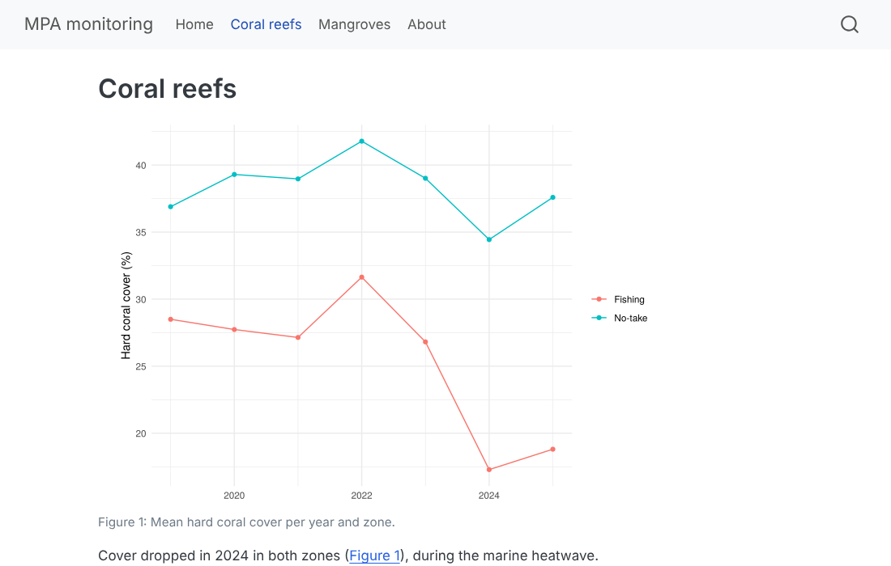

```{r setup, include=FALSE}
source("R/course_helpers.R")
```

::: objectives
::: en
#### By the end of this session you will be able to
- choose between **Typst** and **LaTeX** to make a PDF, and install what is needed;
- control the **page layout**: paper size, margins, fonts, page breaks, figure sizes; and use a Word template;
- build a small **Quarto website** (several pages, navigation bar) from your project;
- **publish** it on **GitHub Pages**, **GitLab Pages** or **Quarto Pub**;
- decide **what may be published** and what must stay private.
:::
::: fr
#### À la fin de cette séance vous saurez
- choisir entre **Typst** et **LaTeX** pour faire un PDF, et installer ce qu'il faut ;
- contrôler la **mise en page** : format du papier, marges, polices, sauts de page, taille des figures ; et utiliser un modèle Word ;
- construire un petit **site Quarto** (plusieurs pages, barre de navigation) à partir de votre projet ;
- le **publier** sur **GitHub Pages**, **GitLab Pages** ou **Quarto Pub** ;
- décider **ce qui peut être publié** et ce qui doit rester privé.
:::
:::

::: {.callout .ecology}
::: en
**Data of this session (simulated).** The MPA managers want two things: the **mangrove report** as a printable PDF for the regional authorities (Session A8 template), and a small **public website** where partners and communities can see the main results of the monitoring (coral reefs 2019–2025 and mangroves 2025). `mpa-monitoring-site.zip` is a ready-made Quarto website project with these data (reef and mangrove CSV files, references). *Type:* the same tables as Sessions A0–A8; nothing personal — which matters before publishing.
:::
::: fr
**Données de cette séance (simulées).** Les gestionnaires des AMP veulent deux choses : le **rapport mangroves** en PDF imprimable pour les autorités régionales (modèle de la séance A8), et un petit **site web public** où partenaires et communautés peuvent voir les principaux résultats du suivi (récifs 2019–2025 et mangroves 2025). `mpa-monitoring-site.zip` est un projet de site Quarto prêt à l'emploi avec ces données (fichiers CSV récifs et mangroves, références). *Type :* les mêmes tableaux qu'aux séances A0–A8 ; rien de personnel — ce qui compte avant de publier.
:::
:::

`r dl("mpa-monitoring-site.zip", "mpa-monitoring-site.zip", dir = "templates/advanced/quarto")` `r dl("mangrove_report.qmd", "mangrove_report.qmd", dir = "templates/advanced/quarto")`

## [Two ways to make a PDF]{.en}[Deux façons de faire un PDF]{.fr} {#pdf}

::: en
| | **Typst** (`format: typst`) | **LaTeX** (`format: pdf`) |
|---|---|---|
| install | nothing: included in Quarto | once: `quarto install tinytex` (Terminal), ≈ 300 MB; missing LaTeX packages are then installed automatically |
| speed | very fast | slower |
| table of contents, numbered sections | yes | yes |
| lists of figures and tables (`lof`, `lot`) | no | **yes** |
| journal templates, thesis classes | few, growing | many (Elsevier, Springer, university classes…) |
| errors | short, readable | long logs |

**Advice:** start with Typst for everyday reports; use LaTeX when you need lists of figures and tables or an official template. Add `citeproc: true` under `typst:` to get the same author–year citations as in HTML.
:::
::: fr
| | **Typst** (`format: typst`) | **LaTeX** (`format: pdf`) |
|---|---|---|
| installation | rien : inclus dans Quarto | une fois : `quarto install tinytex` (Terminal), ≈ 300 Mo ; les packages LaTeX manquants s'installent ensuite automatiquement |
| vitesse | très rapide | plus lent |
| table des matières, sections numérotées | oui | oui |
| listes des figures et des tableaux (`lof`, `lot`) | non | **oui** |
| modèles de revues, classes de thèse | peu, en progression | nombreux (Elsevier, Springer, classes d'universités…) |
| erreurs | courtes, lisibles | longs journaux |

**Conseil :** commencez par Typst pour les rapports courants ; utilisez LaTeX quand il vous faut des listes des figures et des tableaux ou un modèle officiel. Ajoutez `citeproc: true` sous `typst:` pour avoir les mêmes citations auteur–date qu'en HTML.
:::

## [Page layout]{.en}[Mise en page]{.fr} {#layout}

```yaml
format:
  typst:
    papersize: a4
    margin:
      x: 2.5cm               # left and right
      y: 2cm                 # top and bottom
    fontsize: 11pt
    mainfont: "Linux Libertine"   # any font installed on the computer
    toc: true
    number-sections: true
    citeproc: true
  pdf:                        # LaTeX
    papersize: a4
    geometry: margin=2.5cm
    fontsize: 11pt
    linestretch: 1.3          # line spacing
    toc: true
    lof: true
    lot: true
    number-sections: true
    fig-pos: "H"              # keep each figure where it is written
  docx:
    reference-doc: my-styles.docx   # fonts, heading styles and margins of your institution
```

::: en
| Key | Format | What it does | Value it expects |
|---|---|---|---|
| `papersize` | typst, pdf | paper size | `a4`, `a5`, `us-letter` |
| `margin` → `x`, `y` | typst | `x` = left and right margins, `y` = top and bottom (also `left`, `right`, `top`, `bottom` separately) | lengths: `2cm`, `25mm`, `1in` |
| `geometry` | pdf | the same for LaTeX, in the syntax of its *geometry* package: `margin=2.5cm` (all sides) or `top=2cm,bottom=2cm,left=3cm,right=2cm` | text |
| `fontsize` | typst, pdf | size of the body text | `10pt`, `11pt`, `12pt` |
| `mainfont` | typst, pdf | font of the text; it must be **installed** on the computer that renders | font name in quotes |
| `linestretch` | pdf | line spacing: `1` single, `1.5` one and a half, `2` double | a number |
| `fig-pos` | pdf | where LaTeX places figures; `"H"` = exactly here (otherwise LaTeX may move them to the next page) | `"H"`, `"t"` (top), `"b"` (bottom) |
| `reference-doc` | docx | Word file whose **styles** are copied | path to a .docx |

The same thing has **different keys** in Typst (`margin`) and LaTeX (`geometry`): when you switch format, check the keys.
:::
::: en
- **Page break** anywhere: `` on its own line (all formats).
- **Figure size**: `fig-width` and `fig-height` are in **inches** (1 in = 2.54 cm): an A4 page with 2.5 cm margins leaves about 6.3 in of width. Set them once under `execute:` or `format:` and change them in a chunk when needed.
- **Word template**: create the default one with `quarto pandoc -o my-styles.docx --print-default-data-file reference.docx`, open it in Word, change the **styles** (not the text!) — *Heading 1*, *Normal*, *Caption* — and save. Every report rendered with `reference-doc: my-styles.docx` will use them.
- **One HTML file** to send by e-mail: `embed-resources: true` under `html:` puts images, styles and scripts inside the file.
:::
::: fr
| Clé | Format | Ce qu'elle fait | Valeur attendue |
|---|---|---|---|
| `papersize` | typst, pdf | format du papier | `a4`, `a5`, `us-letter` |
| `margin` → `x`, `y` | typst | `x` = marges gauche et droite, `y` = haut et bas (aussi `left`, `right`, `top`, `bottom` séparément) | longueurs : `2cm`, `25mm`, `1in` |
| `geometry` | pdf | la même chose pour LaTeX, dans la syntaxe de son package *geometry* : `margin=2.5cm` (tous les côtés) ou `top=2cm,bottom=2cm,left=3cm,right=2cm` | texte |
| `fontsize` | typst, pdf | taille du texte courant | `10pt`, `11pt`, `12pt` |
| `mainfont` | typst, pdf | police du texte ; elle doit être **installée** sur l'ordinateur qui produit le document | nom de police entre guillemets |
| `linestretch` | pdf | interligne : `1` simple, `1.5` un et demi, `2` double | un nombre |
| `fig-pos` | pdf | où LaTeX place les figures ; `"H"` = exactement ici (sinon LaTeX peut les déplacer à la page suivante) | `"H"`, `"t"` (haut), `"b"` (bas) |
| `reference-doc` | docx | fichier Word dont les **styles** sont copiés | chemin vers un .docx |

La même chose a des **clés différentes** en Typst (`margin`) et en LaTeX (`geometry`) : quand vous changez de format, vérifiez les clés.
:::
::: fr
- **Saut de page** n'importe où : `` seul sur sa ligne (tous formats).
- **Taille des figures** : `fig-width` et `fig-height` sont en **pouces** (1 po = 2,54 cm) : une page A4 avec 2,5 cm de marges laisse environ 6,3 po de largeur. Fixez-les une fois sous `execute:` ou `format:` et changez-les dans un chunk si besoin.
- **Modèle Word** : créez celui par défaut avec `quarto pandoc -o mes-styles.docx --print-default-data-file reference.docx`, ouvrez-le dans Word, modifiez les **styles** (pas le texte !) — *Titre 1*, *Normal*, *Légende* — et enregistrez. Chaque rapport produit avec `reference-doc: mes-styles.docx` les utilisera.
- **Un seul fichier HTML** à envoyer par e-mail : `embed-resources: true` sous `html:` met images, styles et scripts dans le fichier.
:::

::: {.callout .try}
::: en
**Try it.** Render the mangrove report with `--to typst`, then change the margins to 2 cm, the font size to 10pt, and add a page break before the Results. Compare the number of pages.
:::
::: fr
**À vous.** Produisez le rapport mangroves avec `--to typst`, puis passez les marges à 2 cm, la taille de police à 10pt, et ajoutez un saut de page avant les résultats. Comparez le nombre de pages.
:::
:::

## [A Quarto website]{.en}[Un site web Quarto]{.fr} {#website}

::: en
A **Quarto project** is a folder with a `_quarto.yml` file. With `type: website`, every `.qmd` becomes a page, and `quarto render` (in the Terminal, at the root of the project) builds the whole site into `output-dir`. Unzip `mpa-monitoring-site.zip`, open the `.Rproj`, and look at the settings:
:::
::: fr
Un **projet Quarto** est un dossier avec un fichier `_quarto.yml`. Avec `type: website`, chaque `.qmd` devient une page, et `quarto render` (dans le Terminal, à la racine du projet) construit tout le site dans `output-dir`. Décompressez `mpa-monitoring-site.zip`, ouvrez le `.Rproj`, et regardez les réglages :
:::

`r show_file("templates/advanced/quarto/website_quarto.yml", "yaml")`

::: en
| Key in `_quarto.yml` | What it does | Value it expects |
|---|---|---|
| `project` → `type` | kind of project: `website` (pages + menu), `book` (chapters), `default` (separate documents) | one of these words |
| `project` → `output-dir` | folder where the finished site is written; `docs` because GitHub Pages can publish a folder of that name | a folder name |
| `website` → `title` | name of the site, shown at the left of the menu bar and in the browser tab | text |
| `navbar` | the **nav**igation **bar**: the menu at the top of every page | `left:` and/or `right:` lists |
| `left`, `right` | menu items on the left / right of the bar, in this order | a list of items (`- href: …`) |
| `href` | the **link** of a menu item (*h*ypertext *ref*erence): the page to open — a `.qmd` of the project (Quarto turns it into `.html`) or a full web address | file name or URL |
| `text` | the word shown in the menu for this link (otherwise: the title of the page) | text |
| `page-footer` → `left`/`center`/`right` | text at the bottom of every page | text |
| `format` → `html` → `theme` | the look of the site (colours, fonts): one of the 25 Bootswatch themes, e.g. `cosmo`, `flatly`, `darkly` | a theme name |
| `execute` → `freeze` | `auto`: re-run the R code of a page only when its `.qmd` changed (below) | `auto`, `true`, `false` |

A menu item can be written short (`- coral.qmd`, the text is then the page title) or long (`- href:` + `text:`).
:::
::: fr
| Clé de `_quarto.yml` | Ce qu'elle fait | Valeur attendue |
|---|---|---|
| `project` → `type` | type de projet : `website` (pages + menu), `book` (chapitres), `default` (documents séparés) | un de ces mots |
| `project` → `output-dir` | dossier où le site fini est écrit ; `docs` car GitHub Pages sait publier un dossier de ce nom | un nom de dossier |
| `website` → `title` | nom du site, affiché à gauche de la barre de menu et dans l'onglet du navigateur | texte |
| `navbar` | la **barre de navigation** (*navigation bar*) : le menu en haut de chaque page | des listes `left:` et/ou `right:` |
| `left`, `right` | éléments du menu à gauche / à droite de la barre, dans cet ordre | une liste d'éléments (`- href: …`) |
| `href` | le **lien** d'un élément du menu (*hypertext reference*) : la page à ouvrir — un `.qmd` du projet (Quarto le transforme en `.html`) ou une adresse web complète | nom de fichier ou URL |
| `text` | le mot affiché dans le menu pour ce lien (sinon : le titre de la page) | texte |
| `page-footer` → `left`/`center`/`right` | texte en bas de chaque page | texte |
| `format` → `html` → `theme` | l'apparence du site (couleurs, polices) : un des 25 thèmes Bootswatch, ex. `cosmo`, `flatly`, `darkly` | un nom de thème |
| `execute` → `freeze` | `auto` : ne relance le code R d'une page que si son `.qmd` a changé (ci-dessous) | `auto`, `true`, `false` |

Un élément de menu peut s'écrire court (`- coral.qmd`, le texte est alors le titre de la page) ou long (`- href:` + `text:`).
:::

```
mpa-monitoring-site/
├── _quarto.yml           <- settings of the whole site
├── index.qmd             <- home page (index = the first page)
├── coral.qmd  mangroves.qmd  about.qmd
├── references.bib
├── data/raw/             <- the CSV files
├── .gitignore  .gitlab-ci.yml
└── docs/                 <- created by quarto render: THE WEBSITE
```

```bash
quarto preview        # live preview in the browser while you edit (Ctrl + C to stop)
quarto render         # builds every page into docs/
```

{width=85%}

::: en
`freeze: auto` (in `_quarto.yml`) stores the results of each page in `_freeze/` and re-runs its R code **only when the page changed**: a site with many pages renders quickly, and a collaborator can render the site **without** your data or packages. Commit `_freeze/` with the rest.
:::
::: fr
`freeze: auto` (dans `_quarto.yml`) garde les résultats de chaque page dans `_freeze/` et ne relance son code R **que si la page a changé** : un site de nombreuses pages se construit vite, et un collaborateur peut produire le site **sans** vos données ni vos packages. Versionnez `_freeze/` avec le reste.
:::

## [Publishing]{.en}[Publier]{.fr} {#publish}

### [GitHub Pages]{.en}[GitHub Pages]{.fr}

::: en
1. Render the site into `docs/` and create an empty file `docs/.nojekyll` once (`file.create("docs/.nojekyll")`) — it tells GitHub to serve the files as they are. `file.create(path)` creates an empty file (it returns `TRUE` if it worked).
2. Commit **everything** (sources, `_freeze/`, `docs/`) and push (Session A2).
3. On GitHub: *Settings → Pages → Build and deployment → Deploy from a branch → main / docs → Save*.
4. After a minute: `https://<your-account>.github.io/mpa-monitoring-site/`. This course website is published exactly this way.

Alternative: `quarto publish gh-pages` renders the site and pushes it to a separate `gh-pages` branch for you (then `docs/` is not needed).

On a **free** GitHub account, Pages only works for **public** repositories (private ones need a paid plan).
:::
::: fr
1. Produisez le site dans `docs/` et créez une fois un fichier vide `docs/.nojekyll` (`file.create("docs/.nojekyll")`) — il dit à GitHub de servir les fichiers tels quels. `file.create(chemin)` crée un fichier vide (il renvoie `TRUE` si cela a marché).
2. Validez **tout** (sources, `_freeze/`, `docs/`) et poussez (séance A2).
3. Sur GitHub : *Settings → Pages → Build and deployment → Deploy from a branch → main / docs → Save*.
4. Une minute plus tard : `https://<votre-compte>.github.io/mpa-monitoring-site/`. Ce site de cours est publié exactement ainsi.

Variante : `quarto publish gh-pages` produit le site et le pousse pour vous sur une branche séparée `gh-pages` (alors `docs/` n'est pas nécessaire).

Avec un compte GitHub **gratuit**, Pages ne fonctionne que pour les dépôts **publics** (les dépôts privés demandent un abonnement payant).
:::

### [GitLab Pages]{.en}[GitLab Pages]{.fr}

::: en
GitLab publishes what a small **CI job** puts in a folder named `public/`. The template contains this `.gitlab-ci.yml`: at each push on `main`, it copies your rendered `docs/` into `public/`. The site appears at `https://<your-account>.gitlab.io/mpa-monitoring-site/` (see *Deploy → Pages* in the project). GitLab Pages also works for **private** projects, and *Settings → General → Visibility → Pages* can restrict the site to project members.
:::
::: fr
GitLab publie ce qu'une petite **tâche CI** place dans un dossier nommé `public/`. Le modèle contient ce `.gitlab-ci.yml` : à chaque push sur `main`, il copie votre `docs/` produit dans `public/`. Le site apparaît à `https://<votre-compte>.gitlab.io/mpa-monitoring-site/` (voir *Deploy → Pages* dans le projet). GitLab Pages fonctionne aussi pour les projets **privés**, et *Settings → General → Visibility → Pages* peut réserver le site aux membres du projet.
:::

`r show_file("templates/advanced/quarto/gitlab-ci.yml", "yaml")`

::: en
| Key | What it does |
|---|---|
| `pages` | name of the job; GitLab publishes a site only from a job called **`pages`** |
| `stage: deploy` | the step of the pipeline in which the job runs (`deploy` = publication) |
| `script` | the commands run by GitLab on its own computer, one per line: `mkdir -p public` creates the folder, `cp -r docs/* public/` copies the site in it |
| `artifacts` → `paths` | the files to **keep** when the job ends; `public` is the folder GitLab Pages publishes |
| `rules` → `if` | when the job runs: here only when the commit is on the `main` branch (`$CI_COMMIT_BRANCH` is a variable filled by GitLab) |

You see each run in *Build → Pipelines* (green = published, red = click to read the error).
:::
::: fr
| Clé | Ce qu'elle fait |
|---|---|
| `pages` | nom de la tâche ; GitLab ne publie un site qu'à partir d'une tâche appelée **`pages`** |
| `stage: deploy` | l'étape du pipeline où la tâche s'exécute (`deploy` = publication) |
| `script` | les commandes exécutées par GitLab sur son propre ordinateur, une par ligne : `mkdir -p public` crée le dossier, `cp -r docs/* public/` y copie le site |
| `artifacts` → `paths` | les fichiers à **garder** à la fin de la tâche ; `public` est le dossier que GitLab Pages publie |
| `rules` → `if` | quand la tâche s'exécute : ici seulement quand le commit est sur la branche `main` (`$CI_COMMIT_BRANCH` est une variable remplie par GitLab) |

Chaque exécution est visible dans *Build → Pipelines* (vert = publié, rouge = cliquez pour lire l'erreur).
:::

### [Quarto Pub]{.en}[Quarto Pub]{.fr}

::: en
The quickest way for a single report or a small site: `quarto publish quarto-pub` (free account at <https://quartopub.com>). Everything published there is **public**.
:::
::: fr
Le plus rapide pour un rapport seul ou un petit site : `quarto publish quarto-pub` (compte gratuit sur <https://quartopub.com>). Tout ce qui y est publié est **public**.
:::

::: {.callout .warning}
::: en
**Before you publish, check:** no names, phone numbers or GPS positions of people or households (survey data!); no exact positions of sensitive resources (spawning aggregations, sea cucumber stocks, nesting beaches) if poachers could use them; the agreement of the data owners (communities, MPA managers, the NGO). A public repository shows **all its history**: a file deleted today is still visible in old commits.
:::
::: fr
**Avant de publier, vérifiez :** pas de noms, téléphones ou positions GPS de personnes ou de ménages (données d'enquête !) ; pas de positions exactes de ressources sensibles (agrégations de reproduction, stocks d'holothuries, plages de ponte) si des braconniers pouvaient s'en servir ; l'accord des propriétaires des données (communautés, gestionnaires d'AMP, ONG). Un dépôt public montre **tout son historique** : un fichier supprimé aujourd'hui reste visible dans les anciens commits.
:::
:::

## [Application work & quiz]{.en}[Travail d'application et quiz]{.fr} {#application}

```{r answers, include=FALSE}
files <- utils::unzip("templates/advanced/quarto/mpa-monitoring-site.zip", list = TRUE)$Name
a1 <- sum(grepl("\\.qmd$", files))
yml <- readLines("templates/advanced/quarto/mangrove_report.qmd")
fmt_start <- which(yml == "format:"); fmt_end <- which(yml == "bibliography: references.bib")
a2 <- sum(grepl("^  [a-z]+:$", yml[(fmt_start + 1):(fmt_end - 1)]))
```

::: application
::: en
### Application work A9

1. Render the mangrove report to PDF with **Typst**; then, if you can, with **LaTeX** (`quarto install tinytex` first). Which one has a list of figures?
2. Make a Word style file, change the font and the colour of *Heading 1*, and render the report to Word with `reference-doc`.
3. Unzip `mpa-monitoring-site.zip`. How many pages (`.qmd` files) does the site have? How many output formats does the YAML of `mangrove_report.qmd` define?
4. Add a page `methods.qmd` to the site (link it in the navbar) and run `quarto preview`.
5. Make the site a Git repository, push it to **GitHub or GitLab**, and publish it (Pages). Send the address to your teacher.
:::
::: fr
### Travail d'application A9

1. Produisez le rapport mangroves en PDF avec **Typst** ; puis, si vous pouvez, avec **LaTeX** (`quarto install tinytex` d'abord). Lequel a une liste des figures ?
2. Faites un fichier de styles Word, changez la police et la couleur du *Titre 1*, et produisez le rapport en Word avec `reference-doc`.
3. Décompressez `mpa-monitoring-site.zip`. Combien de pages (fichiers `.qmd`) le site contient-il ? Combien de formats de sortie le YAML de `mangrove_report.qmd` définit-il ?
4. Ajoutez une page `methods.qmd` au site (avec un lien dans la barre de navigation) et lancez `quarto preview`.
5. Faites du site un dépôt Git, poussez-le sur **GitHub ou GitLab**, et publiez-le (Pages). Envoyez l'adresse à votre enseignante.
:::
:::

::: hint
::: en
If GitHub Pages shows a 404 page: check the folder (`/docs`) in *Settings → Pages*, that `docs/index.html` exists in the repository, and wait one or two minutes. If the pages have no style, `docs/.nojekyll` is missing or the `site_libs/` folder was not committed.
:::
::: fr
Si GitHub Pages affiche une page 404 : vérifiez le dossier (`/docs`) dans *Settings → Pages*, que `docs/index.html` existe dans le dépôt, et attendez une ou deux minutes. Si les pages n'ont pas de mise en forme, `docs/.nojekyll` manque ou le dossier `site_libs/` n'a pas été validé.
:::
:::

```{r quiz, echo=FALSE}
quiz("a09", list(
  q_num("3a. Number of .qmd pages in the website template?", "3a. Nombre de pages .qmd dans le modèle de site ?", a1, tol = 0),
  q_num("3b. Number of output formats in the YAML of mangrove_report.qmd?", "3b. Nombre de formats de sortie dans le YAML de mangrove_report.qmd ?", a2, tol = 0),
  q_mcq("1. Which PDF engine needs nothing more than Quarto?", "1. Quel moteur PDF ne demande rien de plus que Quarto ?",
        c("LaTeX", "Typst", "Word", "pandoc-citeproc"),
        c("LaTeX", "Typst", "Word", "pandoc-citeproc"), correct = 2),
  q_mcq("4. You need a List of Figures and a List of Tables in a PDF. You use:", "4. Il vous faut une liste des figures et une liste des tableaux dans un PDF. Vous utilisez :",
        c("format: typst with toc: true", "format: pdf (LaTeX) with lof: true and lot: true", "format: html", ""),
        c("format: typst avec toc: true", "format: pdf (LaTeX) avec lof: true et lot: true", "format: html", ""), correct = 2),
  q_mcq("5. fig-width: 6 means a figure:", "5. fig-width: 6 signifie une figure :",
        c("6 cm wide", "6 inches (≈ 15 cm) wide", "6 % of the page", "with 6 panels"),
        c("de 6 cm de large", "de 6 pouces (≈ 15 cm) de large", "de 6 % de la page", "avec 6 panneaux"), correct = 2),
  q_mcq("6. On a free GitHub account, GitHub Pages can publish:", "6. Avec un compte GitHub gratuit, GitHub Pages peut publier :",
        c("only public repositories", "private repositories too", "only repositories with Quarto", "nothing"),
        c("seulement des dépôts publics", "aussi des dépôts privés", "seulement des dépôts avec Quarto", "rien"), correct = 1),
  q_mcq("7. What does freeze: auto do in a Quarto website?", "7. Que fait freeze: auto dans un site Quarto ?",
        c("Blocks the site from being edited", "Re-runs the R code of a page only when that page changed", "Freezes package versions like renv", "Prevents publishing"),
        c("Empêche de modifier le site", "Ne relance le code R d'une page que si cette page a changé", "Fige les versions des packages comme renv", "Empêche la publication"), correct = 2),
  q_mcq("8. You deleted a file with phone numbers and pushed again to a public repository. The file:", "8. Vous avez supprimé un fichier contenant des téléphones et poussé à nouveau sur un dépôt public. Le fichier :",
        c("is gone for good", "is still visible in the history of old commits", "is hidden automatically by GitHub", "is moved to a private branch"),
        c("a disparu pour de bon", "reste visible dans l'historique des anciens commits", "est caché automatiquement par GitHub", "est déplacé sur une branche privée"), correct = 2),
  q_mcq("9. In _quarto.yml, under navbar: left:, what does href: coral.qmd give?", "9. Dans _quarto.yml, sous navbar: left:, que donne href: coral.qmd ?",
        c("The page the menu item links to", "The title of the site", "The folder of the site", "The colour of the menu"),
        c("La page vers laquelle pointe l'élément du menu", "Le titre du site", "Le dossier du site", "La couleur du menu"), correct = 1),
  q_mcq("10. To set 2.5 cm margins in a LaTeX PDF (format: pdf) you write:", "10. Pour des marges de 2,5 cm dans un PDF LaTeX (format: pdf) on écrit :",
        c("geometry: margin=2.5cm", "margin: x: 2.5cm", "papersize: 2.5cm", "fontsize: 2.5cm"),
        c("geometry: margin=2.5cm", "margin: x: 2.5cm", "papersize: 2.5cm", "fontsize: 2.5cm"), correct = 1)
))
```

::: {.solution data-quiz="a09"}
```bash
# 1
quarto render reports/mangrove_report.qmd --to typst
quarto install tinytex
quarto render reports/mangrove_report.qmd --to pdf     # this one has the List of Figures / Tables
# 2
quarto pandoc -o my-styles.docx --print-default-data-file reference.docx
#   ...edit the styles in Word, then in the YAML:  docx: reference-doc: my-styles.docx
# 3: index, coral, mangroves, about = 4 pages; html, typst, pdf, docx = 4 formats
# 4: methods.qmd + in _quarto.yml, under navbar: left:   - href: methods.qmd
quarto preview
# 5
git init -b main && git add . && git commit -m "First version of the monitoring website"
git remote add origin git@github.com:your-account/mpa-monitoring-site.git
quarto render && touch docs/.nojekyll && git add . && git commit -m "Render the site" && git push -u origin main
#   then Settings -> Pages -> main /docs
```
:::
